# Tuning Fork

**Find the step where your agent's skill goes wrong, test rewordings right there, and measure
which fix works — on local LLMs.**

[](https://github.com/hhuang91/tuningfork/actions/workflows/tests.yml)
[](LICENSE)
[](pyproject.toml)
[](CHANGELOG.md)

<p>
<picture>
  <source media="(prefers-color-scheme: dark)" srcset="docs/images/hero-dark.svg">
  
</picture>
</p>

tuningfork sits between your agent and your local model, and records every call the agent
makes. When a skill fails, it finds the step where the runs go wrong, and shows how the model
wavers there, down to its odds for each word of its reasoning. Then it sends that step to the
model again and again, everything before it held fixed, once as written and once with your edit,
and tells you whether the difference is real.

It works with **Hermes Agent** and **Claude Code** on **llama.cpp**, from a terminal, a web UI,
or an agent over MCP. It is pre-alpha: commands and their output may still change.

## Why

You write a skill — an [agentskills.io](https://agentskills.io)-style `SKILL.md` — for a local
agent. It works three times out of five. So you reword it, run the task five more times, and
squint at the results. That loop is broken in two ways:

- **Small samples are noise.** 3/5 is consistent with a true success rate anywhere from 23% to
  88% (95% Wilson interval). Separating a 60% skill from a 90% one takes roughly 30 runs per
  variant. Almost nobody does that, so wording decisions get made on noise.
- **Wording sensitivity is real, and model-specific.** Open models swing hard on
  meaning-preserving format changes, and the best format does not transfer between models
  ([Sclar et al., ICLR 2024](https://arxiv.org/abs/2310.11324)). Every model swap or
  quantization change means partial retuning.

tuningfork treats an agent run as a program and the skill as its source code, and supplies the
missing debugger:

- **Record** every model call, with the exact context the model saw, or import a conversation
  your agent already had.
- **Localize** the first step where successful and failed runs diverge.
- **Resample** that step N times from a checkpoint, its history held fixed, and count what the
  model does.
- **Look inside the step**: the model's own odds at each token of its answer, and the word where
  its reasoning forks.
- **A/B the wording there**, and report the difference with a confidence interval and a
  significance test instead of a bare percentage.
- **Break** a live call before or after the model, and read or edit its whole context.

Pausing and editing LLM traffic is table stakes; several tools do it. The point here is
**measurement and localization for instruction text**.

## See it work

The toy skill in [`examples/find-the-file/`](examples/find-the-file/README.md) summarizes a CSV
into `report.json`, and says that if the file is not there, the agent should say so and stop.
The request names `data.csv`, but the file is in a subfolder. Ten runs through Hermes Agent, on
Gemma 4 31B:

```console
$ tuningfork batch examples/find-the-file/evals.json -n 10 --harness hermes --model gemma-4-31b
...
4/10  40%  [17%-69%] passed
```

Every run first read `data.csv` where the request names it, and found nothing. Then it either
searched for the file and passed, or gave up and failed. Bad luck, or the wording? Sent to the
model twenty more times with its history held fixed, that step gives up 16 times. Scored, its
answer shows where the reasoning forks. After "…but it was not found.", the next word is
"According" at 80%, which goes on "…I should say so and stop", or "Wait" at 7%, which goes on
"…search for it first?". The model wavers there, so one line of the skill can tip it. Tested at
that step, toward a target declared before the first sample:

```console
$ tuningfork ab <run> 1 --variant examples/find-the-file/fix/SKILL.md \
    --target-rules '[{"if": "calls", "value": "search_files"}]'
...
target (declared before sampling): a behaviour that calls search_files
  original  4/20  20% [8%-42%]
  variant   20/20 100% [84%-100%]
  Fisher exact p = 1.5e-07 → significant at α=0.05, variant higher
```

Full runs agree: with the edit in every run, 10/10 pass [72%-100%], against 4/10 before
(Fisher p = 0.011). Every rate comes with its 95% interval, and an A/B without a declared target
is labelled exploratory and corrected for every comparison it makes.
[The example](examples/find-the-file/README.md) shows each command with its output.

In the web UI, an A/B is a few clicks from a run's step (here on the demo's scripted model, which
answers at once; [the quickstart](#try-it-without-a-gpu-five-minutes) starts it):

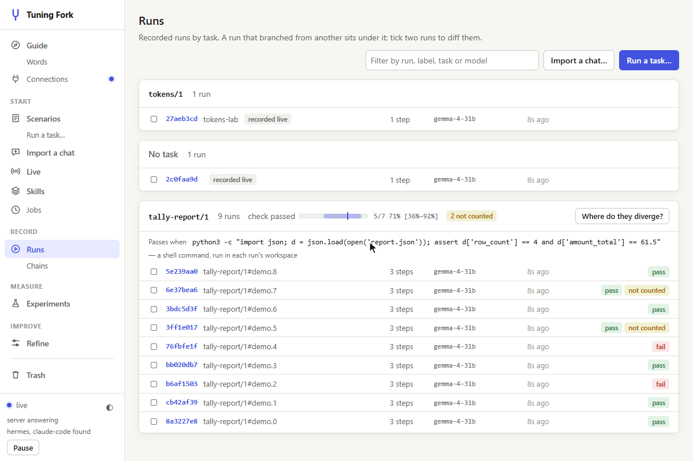

The [step-by-step guide](examples/README.md) walks through every part of the tool on another toy
skill, with Claude Code beside Hermes, and every output in it is from a real run.

## Quickstart

tuningfork runs on Linux, or on Windows inside WSL 2, with Python 3.12 or later. It is not on
PyPI yet: install it from GitHub with [uv](https://docs.astral.sh/uv/), which fetches Python
itself if you need it. Under WSL, keep the checkout on the Linux file system (`~/…`), never
under `/mnt/c`, where SQLite's locking does not work; [on Windows](docs/setup.md#on-windows) has
the steps, and a way to keep the checkout on Windows instead.

### Try it without a GPU (five minutes)

```bash
git clone https://github.com/hhuang91/tuningfork.git
cd tuningfork
uv sync
source .venv/bin/activate
python tests/browser/demo.py lab /tmp/tuningfork-lab 8790    # made-up runs, a scripted model
```

Open the web UI at the address it prints. The runs are made up, nine of the example task with a
resample and an A/B, but tuningfork's own proxy serves them, in front of a scripted model that
answers at once, so every button works. To make the A/B above, open run `tally-report/1#demo.2`,
its step 1, and *A/B a wording…*. The scripted model writes the keys the check wants only for a
wording that names them in these exact words: `row_count and amount_total`
([step by step](docs/images/README.md#the-gif-step-by-step)).
[Part 1 of the guide](examples/README.md#part-1--tuningfork-without-a-model) tours runs like these
from the terminal, then stops a live call at a breakpoint and changes it, still with no model.

### On your own agent

You need a GPU that fits your model, [llama.cpp](https://github.com/ggml-org/llama.cpp)'s
`llama-server`, and a harness: [Hermes Agent](https://github.com/NousResearch/hermes-agent) or
[Claude Code](https://code.claude.com/docs/en/overview) ([the versions we use](docs/setup.md#the-harnesses)).
On Linux, install [bubblewrap](https://github.com/containers/bubblewrap) too (`sudo apt install
bubblewrap`), so that every run sees the same folders: the model reads them
([why it matters](docs/setup.md#the-sandbox)).

1. **Start the model server**, with the flags that make its numbers repeat
   ([why](docs/setup.md#numbers-that-repeat)). This is the guide's, Gemma 4 31B in about 24 GiB:

   ```bash
   llama-server -hf lmstudio-community/gemma-4-31B-it-GGUF:Q4_K_M --no-mmproj \
     --alias gemma-4-31b --host 127.0.0.1 --port 8081 \
     -ngl 999 -c 131072 -np 1 -ctk q4_0 -ctv q4_0 --jinja --ctx-checkpoints 0 --no-cache-prompt
   ```

2. **Start tuningfork** in front of it. It records to `~/.tuningfork` and prints the web UI's
   address:

   ```bash
   tuningfork serve --upstream http://127.0.0.1:8081
   ```

   `--upstream` is the model server it forwards each call to. The harnesses tuningfork
   launches are pointed at tuningfork's own proxy for you. To record running agents as you
   use them, connect them by setting their base URL (where they send their model calls) to
   tuningfork's proxy:
   `http://127.0.0.1:8787/v1` for agents that use an OpenAI-style API, such as Hermes Agent,
   or `http://127.0.0.1:8787` for those that use Anthropic's, such as Claude Code.
   `--port` (or `TUNINGFORK_PORT`) moves the proxy to another port, and `TUNINGFORK_PROXY` then
   tells the other commands where it is. Keep it on `127.0.0.1`, the default: anything that can
   reach the port can read your recordings and send calls to your model
   ([what it guards](SECURITY.md)). From another machine, forward the port over SSH instead:
   `ssh -L 8787:127.0.0.1:8787 <host>`.

3. **Check the server**, in a second terminal with the venv activated: can it do what the
   harnesses need, and does it process every prompt whole?

   ```bash
   tuningfork connections check
   ```

4. **Record runs of a task** — a prompt, its input files and a pass/fail check
   ([the format](docs/setup.md#a-task)):

   ```bash
   tuningfork batch examples/tally-report.evals.json -n 8 --harness hermes    # or --harness claude-code
   ```

   Or start from what your agent did: a conversation it already had imports as a run
   (`tuningfork import`, from a Hermes session file or export), and any run, imported or
   recorded as you used it, becomes a task of its own (`tuningfork scenario <run> <name>`).

5. **Look at them** in the web UI, at the address `serve` printed, or in a terminal:
   [what you can do](#what-you-can-do).

[`docs/setup.md`](docs/setup.md) has the rest: other servers, the harnesses, the sandbox, a
pinned clock, and protecting a server that matters.

## How it works

tuningfork is a recording proxy at the seam between the harness and the model server. It speaks
both OpenAI chat completions and Anthropic Messages, so a harness that takes a custom base URL
goes through it unchanged.

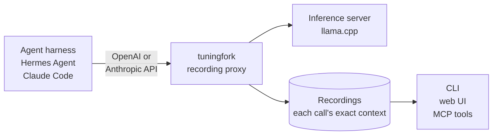

Model requests are stateless: every request carries the model's whole context. So the proxy
sees the full state of the program at every step without touching the harness's code, and any
step can be sent again — as recorded, or with the skill's text swapped for an edit. A *fork*
goes further: it relaunches the harness on the same task, answers its calls from the recording
up to the step, and lets it run live from there to the end, where the task's check decides.

The work goes round one loop, from a skill to its next version, and the commands below follow
it:

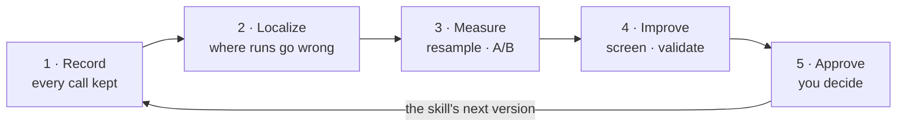

## What you can do

Grouped by the question each answers; each is run as `tuningfork <command>`. Every command takes
`--help`, and [`docs/commands.md`](docs/commands.md) lists them all with their main options. The
[web UI](#the-web-ui) does nearly all of it with a click, and an agent can do the reading,
measuring and refining itself, over MCP ([`docs/agents.md`](docs/agents.md)).

### Does my skill work?

| Command | What it tells you |
|---|---|
| `batch spec.json -n 8` | Runs a task N times through the harness, each run in a fresh workspace, judged by the task's check |
| `scenario <run> <name>` | Any run as a task of its own: each run continues its conversation from the person's message the skill came in after, judged by a check |
| `tasks` | The pass rates with their intervals: one row per harness, model and version of the skill |
| `runs --failed` | The recorded runs, newest first: here the failed ones, to pick one to study |
| `recheck <run>` | Judges a recorded run again, by its own check or one you are trying out (`--check`), recording nothing |

### What happened in a run?

| Command | What it tells you |
|---|---|
| `show <run>` | Its steps, and what the model did at each |
| `timeline <run>` | The run as one conversation, each step's answer where it happened, reasoning included |
| `step <run> <step>` | One step: the exact context the model saw, and what it did |
| `files <run> <step>` | The workspace as that step's call found it (`end`: as the run left it; `--diff`) |
| `diff <runA> <runB>` | Two runs, step by step |
| `import chat.json` | A conversation your agent had elsewhere (a Hermes session file or export, a list of messages) as a run, each turn a step the commands here work on |

### Where do the runs go wrong?

| Command | What it tells you |
|---|---|
| `divergence --task <id>` | The first step where a task's runs stop agreeing, and how the runs that did each thing fared |
| `tally --task <id>` | What the failed runs' checks said, counted: the most common failure first |
| `check-along --task <id>` | The check run again after every call that changed the files: which call made each finding |
| `where --task <id> --file F` | One question asked of every run — of a file it wrote (`--contains`), or of what the model did (`--match`) — lined up with the verdicts: the call that made the difference |

### Bad luck, or the wording?

| Command | What it tells you |
|---|---|
| `resample <run> <step> -n 20` | The step sent again N times, its history held fixed: how often the model does each thing there |
| `ab <run> <step> --variant SKILL.v2.md --target-match RE` | Your edit against the original at that step, toward a target declared before sampling |
| `ab … --to-end` | The same, each sample a fork run to the end and judged by the task's check |
| `fork <run> <step>` | The run replayed up to the step and live from there, with breakpoints armed |

A step is named by its number, or by what the model did there: `write_file` is the first step
where it called that tool.

### Which token decided it?

These need llama.cpp, and a model whose raw output tuningfork reads: Gemma 4 today.

| Command | What it tells you |
|---|---|
| `tokens <run> <step> --score` | The answer as the model's tokens: how sure it was of each, as a heatmap |
| `forking-tokens <run> <step>` | Each likely alternative forced at the uncertain tokens: which ones change what the model does |

### What is the model doing right now?

| Command | What it tells you |
|---|---|
| `break add --tool write_file --path '*.json'` | Stops a live call after the model answers, before the harness acts; `--from-step 2` stops before the model sees step 2 |
| `hold wait` | Waits for a held call and shows it: `hold continue` (`--edited f.json`), `hold step` or `hold drop` decides it |
| `pause` | Refuses model calls until `resume` |

### How do I fix the skill?

A *refinement* declares what the step should do before anything is proposed, screens each edit
against the original, validates a survivor with full runs — held-out tasks included — and
writes it into the skill only when you approve it.

| Command | What it tells you |
|---|---|
| `refine start <run> <step> --target-rules '[…]'` | Names the step, and what the model should do there |
| `refine propose <id> --file SKILL.md --why '…'` | Your own edit; `--builtin` asks a model for edits from the evidence |
| `refine screen <id> -n 20` | Each edit against a fresh arm of the original, Holm-corrected; `--to-end` lets the check decide |
| `refine validate <id> <proposal>` | Full runs: forks to the end, the task from its first step, and each held-out task |
| `refine approve <id> <proposal>` | Writes the edit into the skill's file once you type the code it shows, the old file and a changelog beside it |
| `skills` | Every skill the recordings know; `skill <name>` gives each version with its pass rates |

### Setting up, and keeping things tidy

| Command | What it does |
|---|---|
| `serve --upstream URL` | The recording proxy, with its web UI, its jobs and its MCP route |
| `connections check` | Measures whether the server can do what the harnesses and experiments need |
| `ui --home DIR` | The web UI, read-only, over recordings with no proxy running |
| `jobs list` | Work running inside `serve`, started from the web UI or by an agent |
| `spend --run <run>` | What work cost: model calls, tokens and time |
| `trash run <run>` | Sets runs aside, out of every list and rate; `trash purge` deletes them for good |
| `glossary [word]` | tuningfork's words, each defined once |

## The web UI

`tuningfork serve` serves a web UI at the address it prints, and `tuningfork ui` serves the same
pages, read-only, over recordings with no proxy running. Everything above is in it, and it can
start the work as well as show it: a batch of runs, a resample, an A/B, a fork, a refinement.

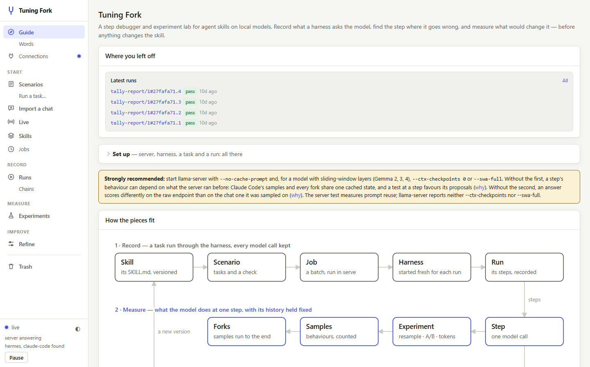

<table>
  <tr>
    <td width="50%">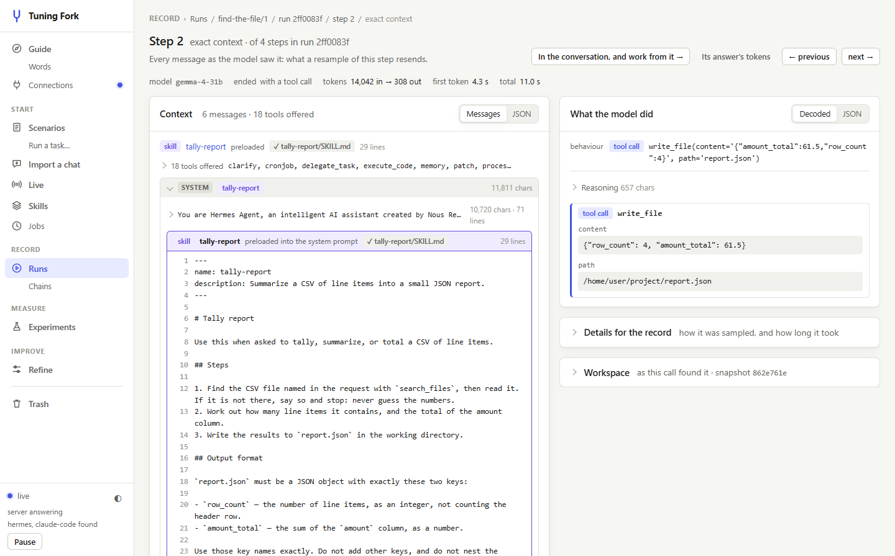</td>
    <td width="50%">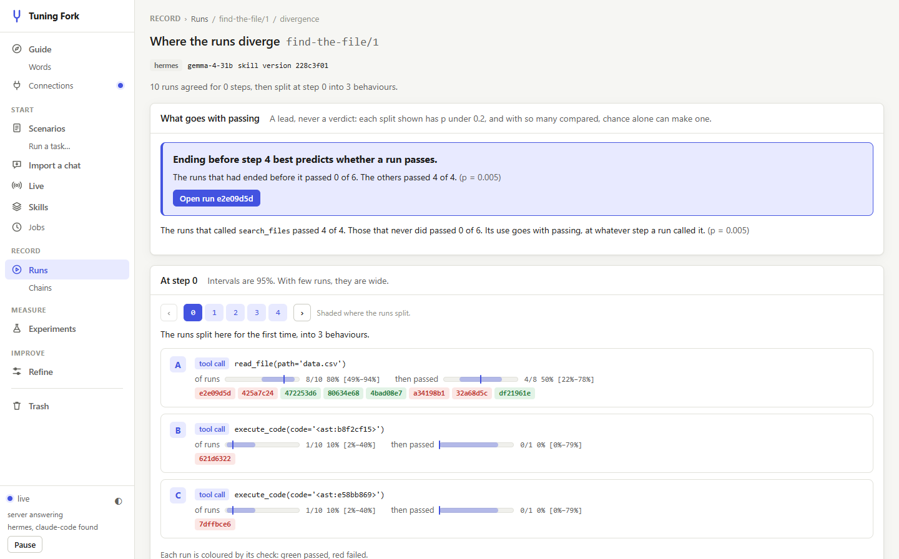</td>
  </tr>
  <tr>
    <td>A step's exact context: every message as the model saw it, the skill marked line by line, and the call it made</td>
    <td>The step that best predicts the verdict, then where a task's runs stop agreeing and how the runs that took each path fared</td>
  </tr>
  <tr>
    <td width="50%">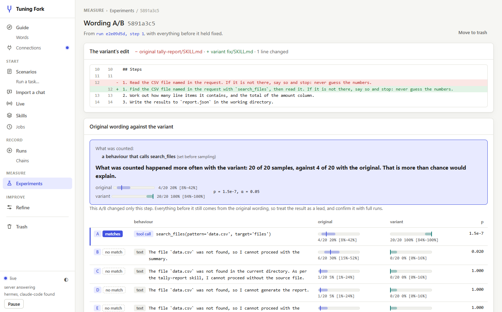</td>
    <td width="50%">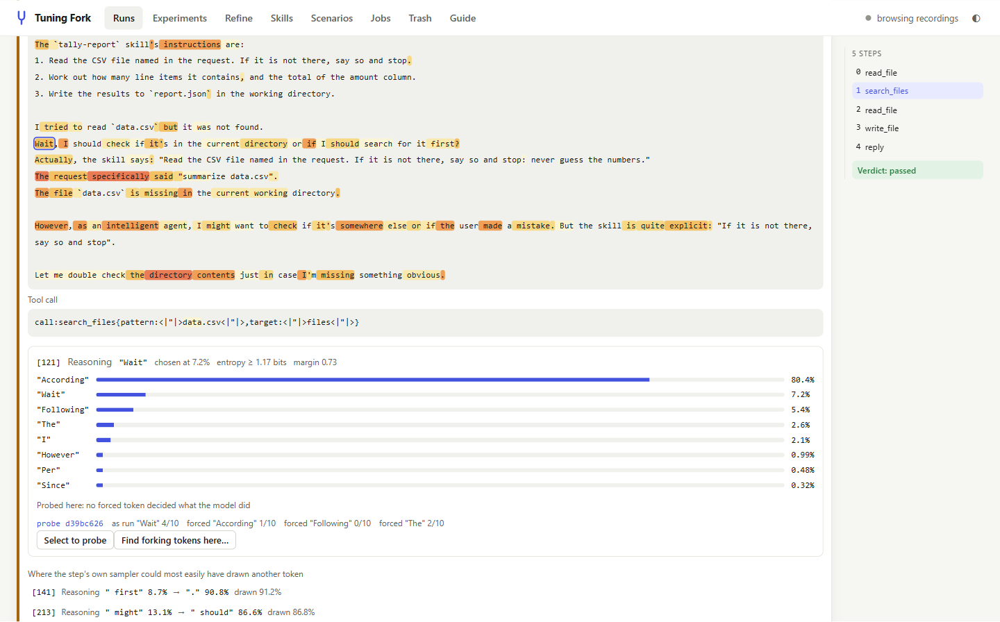</td>
  </tr>
  <tr>
    <td>An A/B at a step: the edit it tested, each arm's rate with its interval, and the test of the target declared before sampling</td>
    <td>An answer as the model's tokens, shaded by how unsure it was; a click shows what else it weighed there</td>
  </tr>
  <tr>
    <td width="50%">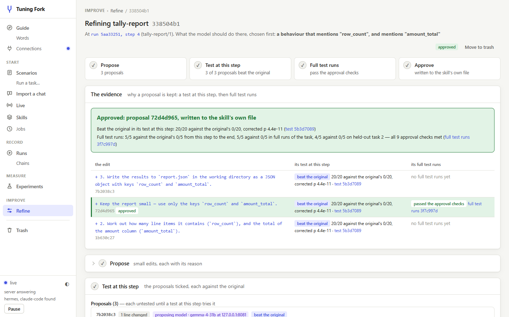</td>
    <td width="50%">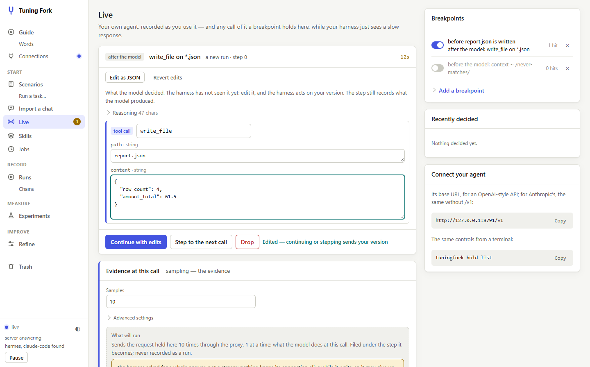</td>
  </tr>
  <tr>
    <td>A refinement: the target declared first and its four stages in a line, then each proposal's screen and the full runs behind the one approved</td>
    <td>A call held at a breakpoint, edited in place before the harness gets it</td>
  </tr>
  <tr>
    <td colspan="2">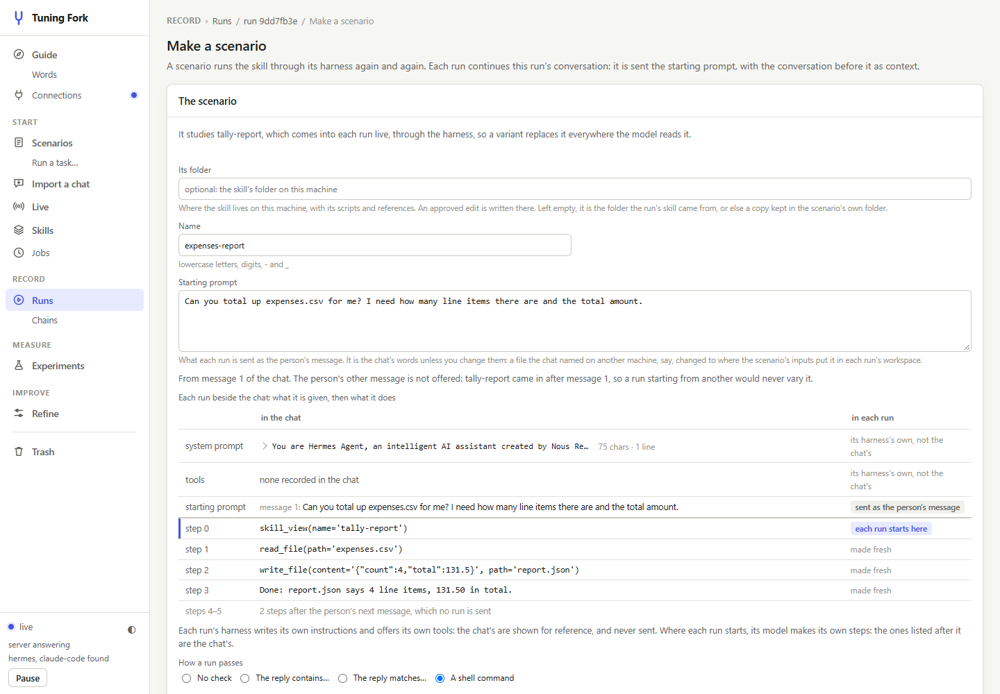</td>
  </tr>
  <tr>
    <td colspan="2">A chat had elsewhere, imported and made a scenario: each run is sent the person's message with the conversation before it, and the skill comes in live</td>
  </tr>
</table>

The page changes nothing without the proxy's access token, which is in the address `serve`
prints; `tuningfork token` prints it again.

## Let an agent drive it

Every operation is also a tool for an agent, over the Model Context Protocol
(`tuningfork mcp`). Hermes Agent, Claude Code or OpenJarvis can count what the failed runs'
checks said, find where a task's runs split, read that step, measure it, and screen edits of
its own. No agent is offered anything that approves an edit, sends your recordings to another
model, or shows it a held-out task's verdicts: those stay with you.

[`docs/agents.md`](docs/agents.md) sets it up for each client.
[`examples/hermes-architecture-diagram/`](examples/hermes-architecture-diagram/README.md) is a
case study: Hermes improving one of its own skills with tuningfork's tools, beside Hermes's own
self-improvement loop, on the same local model.

## Guides

- [**Tuning Fork, step by step**](examples/README.md) — every part of the tool, on a toy skill
  made to fail one way: a tour with no GPU, the real experiment with Claude Code and Hermes
  Agent, a look inside a step, and a fix proposed, screened, validated and approved.
- [**A step where the model wavers**](examples/find-the-file/README.md) — the runs behind the
  figure at the top: where the runs part ways, how often the model goes each way, where its
  reasoning forks, and the line that tips it.
- [**A real skill, fixed at the step that fails**](examples/hermes-design-md/README.md) —
  Hermes Agent's own `design-md` skill, from the failing step to an approved edit and the runs
  after it.
- [**The same model, two ways to improve a skill**](examples/hermes-architecture-diagram/README.md)
  — Hermes's own self-improvement loop against Hermes with tuningfork's tools.
- **Reference:** [setup](docs/setup.md) · [commands](docs/commands.md) ·
  [agents over MCP](docs/agents.md) · [writing a harness adapter](docs/adapters/TEMPLATE.md) ·
  `tuningfork glossary` for the words.

## Works with

| | Today |
|---|---|
| **Harnesses** | Hermes Agent and Claude Code, which tuningfork launches, forks and validates. Any other harness that takes a custom base URL is recorded as it runs. Hermes Agent's session files and exports import as runs. |
| **Inference servers** | llama.cpp's `llama-server`, for everything. LM Studio, and other servers that speak OpenAI chat completions or Anthropic Messages, for recording and experiments at a step; `tuningfork connections check` measures what yours supports. A hosted model's API, for recording only: tuningfork sends no API key of its own ([cloud models](docs/setup.md#cloud-models)). |
| **Token-level work** | llama.cpp, with a model whose raw output tuningfork reads: Gemma 4 today. |
| **Systems** | Linux, natively or under WSL 2 on Windows, with Python 3.12, 3.13 or 3.14. macOS is untested, and the sandbox needs Linux. |

What is particular to a harness or a server lives behind an adapter, never in the core:
[`docs/adapters/TEMPLATE.md`](docs/adapters/TEMPLATE.md) is where a new harness starts, and
`tuningfork probe <url>` writes a profile of a server that you can contribute back.

## Contributing

The test suite runs against a scriptable mock server, with no GPU and no model: `uv run pytest`.
[`CONTRIBUTING.md`](CONTRIBUTING.md) says how to set up and what review looks for;
[`SECURITY.md`](SECURITY.md) says how to report a vulnerability, and what tuningfork does and
does not guard. What changed in each version is in [`CHANGELOG.md`](CHANGELOG.md).

## License

Apache-2.0: see [`LICENSE`](LICENSE), and [`NOTICE`](NOTICE) for the work it follows.
