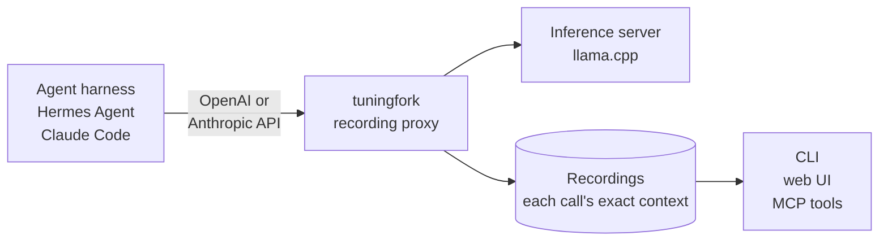
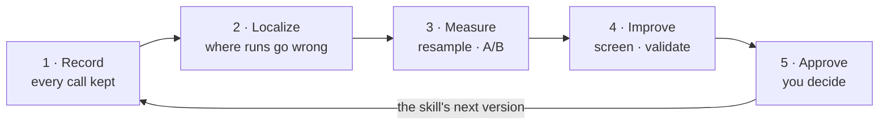

# Tuning Fork

**Tune agent skills to your own model.**

[](https://github.com/hhuang91/tuningfork/actions/workflows/tests.yml)
[](LICENSE)
[](pyproject.toml)
[](CHANGELOG.md)

<p>
<picture>
  <source media="(prefers-color-scheme: dark)" srcset="docs/images/hero-dark.svg">
  
</picture>
</p>

> [See it work](#see-it-work) tells the story behind the figure.

Tuning Fork (`tuningfork`) sits between your agent and your LLM and records every call the agent
makes. If the LLM is the CPU and a skill is source code written in natural language, `tuningfork`
is the debugger you have been missing: it finds the step where a run goes wrong, shows why the
model went that way, down to the odds of each word, and tests your edit to the skill to tell a real fix from luck.

It works with **Hermes Agent** and **Claude Code** on **llama.cpp**, from a terminal, a web UI,
or an agent over MCP.
Any model that llama.cpp serves can be recorded and tested. Seeing the odds of each word works for
Gemma 4, Qwen3.6, Qwen3.5, Qwen3-Coder, Qwen3 and Qwen2.5 so far, and the list will grow as the
repo evolves ([how to serve them](docs/setup.md#the-model-server)).

Tuning Fork is pre-alpha: commands and their output may still change.

## Why

You have a skill ([agentskills.io](https://agentskills.io)-style `SKILL.md`) that works three
times out of five. So you reword it, run the task again, and squint at the session history to see
whether the edit worked; then again at the next failure, in a never-ending whack-a-mole. And when
you change your LLM, most edits seem to lose their effect. This problem happens because:

- **Wording sensitivity is real, and model-specific.** Open models swing hard on meaning-preserving
  format changes, and the best format does not transfer between models ([Sclar et al., ICLR 2024](https://arxiv.org/abs/2310.11324)).
- **Luck looks like progress.** A run that passes after your edit may owe it to one lucky token, not to the edit.
- **No automated tool.** Reading agent session histories is like doing desk check in software development.

## Quickstart

`tuningfork` runs on Linux, or on Windows inside [WSL 2](docs/setup.md#on-windows) (macOS support planned), with Python 3.12 or later.
> Install it with [uv](https://docs.astral.sh/uv/), which fetches Python itself if you need it.

### Try it without a GPU (five-minute UI walkthrough)

```bash
uvx --from tuningfork-lab tuningfork demo
```

Open the web UI at the address it prints. The runs are made up and the model is a script, but
tuningfork's own proxy serves them, so every button works.
[The guide](examples/README.md#test-a-wording-from-the-browser) says what to click, and
[its Part 1](examples/README.md#part-1--tuningfork-without-a-model) installs tuningfork and tours
runs like these from the terminal too.

### Install Tuning Fork (`tuningfork`)

```bash
uv tool install "tuningfork-lab[mcp]"
```

The command is `tuningfork`, and `[mcp]` brings its MCP server. To follow the guides, which use the
repository's examples, clone it instead:

```bash
git clone https://github.com/hhuang91/tuningfork.git
cd tuningfork
uv sync
source .venv/bin/activate
```

The last line activates the environment, so that `tuningfork` and `python` are the environment's own.

### On your own agent

You need a GPU that fits your model, [llama.cpp](https://github.com/ggml-org/llama.cpp)'s
`llama-server`, and a harness: [Hermes Agent](https://github.com/NousResearch/hermes-agent) or
[Claude Code](https://code.claude.com/docs/en/overview) ([the versions we use](docs/setup.md#the-harnesses)).
On Linux, install [bubblewrap](https://github.com/containers/bubblewrap) too (`sudo apt install
bubblewrap`), so that every run sees the same folders: the model reads them
([why it matters](docs/setup.md#the-sandbox)).

1. **Start the model server**, with the flags that make its numbers repeat
   ([why](docs/setup.md#numbers-that-repeat)). This is the guide's, Gemma 4 31B in about 24 GiB:

   ```bash
   llama-server -hf lmstudio-community/gemma-4-31B-it-GGUF:Q4_K_M --no-mmproj \
     --alias gemma-4-31b --host 127.0.0.1 --port 8081 \
     -ngl 999 -c 131072 -np 1 -ctk q4_0 -ctv q4_0 --jinja --ctx-checkpoints 0 --no-cache-prompt
   ```

2. **Start tuningfork** in front of it. It records to `~/.tuningfork` and prints the web UI's
   address:

   ```bash
   tuningfork serve --upstream http://127.0.0.1:8081
   ```

   `--upstream` is the model server it forwards each call to. The harnesses tuningfork
   launches are pointed at tuningfork's own proxy for you. To record running agents as you
   use them, connect them by setting their base URL (where they send their model calls) to
   tuningfork's proxy:
   `http://127.0.0.1:8787/v1` for agents that use an OpenAI-style API, such as Hermes Agent,
   or `http://127.0.0.1:8787` for those that use Anthropic's, such as Claude Code.
   [Recording an agent as you use it](docs/setup.md#recording-an-agent-as-you-use-it) says how
   to move the proxy to another port, and how to reach it from another machine.

3. **Check the server**, in a second terminal with the venv activated: can it do what the
   harnesses need, and does it process every prompt whole?

   ```bash
   tuningfork connections check
   ```

4. **Record runs of a task** — a prompt, its input files and a pass/fail check
   ([the format](docs/setup.md#a-task)):

   ```bash
   tuningfork batch examples/tally-report.evals.json -n 8 --harness hermes    # or --harness claude-code
   ```

   Or start from what your agent did: a conversation it already had imports as a run
   (`tuningfork import`, from a Hermes session file or export), and any run, imported or
   recorded as you used it, becomes a task of its own (`tuningfork scenario <run> <name>`).

5. **Look at them** in the web UI, at the address `serve` printed, or in a terminal:
   [what you can do](#what-you-can-do).

[`docs/setup.md`](docs/setup.md) has the rest: other servers, the harnesses, the sandbox, a
pinned clock, and protecting a server that matters.

## How it works

tuningfork is a recording proxy at the seam between the harness and the model server. It speaks
both OpenAI chat completions and Anthropic Messages, so a harness that takes a custom base URL
goes through it unchanged.



Model requests are stateless: every request carries the model's whole context. So the proxy
sees the full state of the program at every step without touching the harness's code, and any
step can be sent again — as recorded, or with the skill's text swapped for an edit. A *fork*
goes further: it relaunches the harness on the same task, answers its calls from the recording
up to the step, and lets it run live from there to the end, where the task's check decides.

The work goes round one loop, from a skill to its next version, and the commands below follow
it:



## What you can do

Each row is a question, with one command that answers it. The question leads to its part of
[`docs/commands.md`](docs/commands.md), which lists its other commands with their main options,
and every command takes `--help`. The [web UI](#the-web-ui) does nearly all of it with a click,
and an agent can do the reading, measuring and refining itself, over MCP
([`docs/agents.md`](docs/agents.md)).

| Question | For example | What it does |
|---|---|---|
| [Does my skill work?](docs/commands.md#does-my-skill-work) | `tuningfork batch spec.json -n 8` | Runs a task N times, each run judged by the task's check |
| [What happened in a run?](docs/commands.md#what-happened-in-a-run) | `tuningfork timeline <run>` | The run as one conversation, each step's answer where it happened |
| [Where do the runs go wrong?](docs/commands.md#where-do-the-runs-go-wrong) | `tuningfork divergence --task <id>` | The first step where a task's runs stop agreeing, and how the runs that did each thing fared |
| [Bad luck, or the wording?](docs/commands.md#bad-luck-or-the-wording) | `tuningfork ab <run> <step> --variant SKILL.v2.md --target-match RE` | Your edit against the original at that step, its history held fixed, toward a target declared before sampling |
| [Which token decided it?](docs/commands.md#which-token-decided-it) | `tuningfork forking-tokens <run> <step>` | Each likely alternative forced at the uncertain tokens: which ones change what the model does |
| [What is the model doing right now?](docs/commands.md#what-is-the-model-doing-right-now) | `tuningfork break add --tool write_file` | Stops a live call after the model answers, before the harness acts |
| [How do I fix the skill?](docs/commands.md#how-do-i-fix-the-skill) | `tuningfork refine start <run> <step> --target-rules '[…]'` | Starts a refinement, declaring what the step should do; each edit is then tested at the step, and a survivor is tested in full runs and written into the skill only when you approve it |
| [Setting up, and keeping things tidy](docs/commands.md#setting-up-and-keeping-things-tidy) | `tuningfork serve --upstream URL` | The recording proxy, with its web UI, its jobs and its MCP route |

## The web UI

`tuningfork serve` serves a web UI at the address it prints, and `tuningfork ui` serves the same
pages, read-only, over recordings with no proxy running. Everything above is in it, and it can
start the work as well as show it: a batch of runs, a resample, an A/B, a fork, a refinement. Here,
on the demo's scripted model, an A/B is a few clicks from a run's step:


A step's answer can be read as the model's own tokens, shaded by how unsure it was. This is the
figure's fork, in a run that went on to search: the model wrote "Wait" at 7%, where "According"
was at 80%.


[More of its pages](docs/web-ui.md), pictured.

## Let an agent drive it

Every operation is also a tool for an agent, over the Model Context Protocol
(`tuningfork mcp`). Hermes Agent, Claude Code or OpenJarvis can count what the failed runs'
checks said, find where a task's runs split, read that step, measure it, and screen edits of
its own. No agent is offered anything that approves an edit, sends your recordings to another
model, or shows it a held-out task's verdicts: those stay with you.

[`docs/agents.md`](docs/agents.md) sets it up for each client.
[`examples/hermes-architecture-diagram/`](examples/hermes-architecture-diagram/README.md) is a
case study: Hermes improving one of its own skills with tuningfork's tools, beside Hermes's own
self-improvement loop, on the same local model.

## See it work

The toy skill in [`examples/find-the-file/`](examples/find-the-file/README.md) summarizes a CSV
into `report.json`, and says that if the file is not there, the agent should say so and stop.
The request names `data.csv`, but the file is in a subfolder. Ten runs through Hermes Agent, on
Gemma 4 31B:

```console
$ tuningfork batch examples/find-the-file/evals.json -n 10 --harness hermes --model gemma-4-31b
...
4/10  40%  [17%-69%] passed
```

Every run first read `data.csv` where the request names it, and found nothing. Then it either
searched for the file and passed, or gave up and failed. Bad luck, or the wording? Sent to the
model twenty more times with its history held fixed, that step gives up 16 times. Scored, its
answer shows where the reasoning forks. After "…but it was not found.", the next word is
"According" at 80%, which goes on "…I should say so and stop", or "Wait" at 7%, which goes on
"…search for it first?". The model wavers there, so one line of the skill can tip it. Tested at
that step, toward a target declared before the first sample:

```console
$ tuningfork ab <run> 1 --variant examples/find-the-file/fix/SKILL.md \
    --target-rules '[{"if": "calls", "value": "search_files"}]'
...
target (declared before sampling): a behaviour that calls search_files
  original  4/20  20% [8%-42%]
  variant   20/20 100% [84%-100%]
  Fisher exact p = 1.5e-07 → significant at α=0.05, variant higher
```

Full runs agree: with the edit in every run, 10/10 pass [72%-100%], against 4/10 before
(Fisher p = 0.011). Every rate comes with its 95% interval, and an A/B without a declared target
is labelled exploratory and corrected for every comparison it makes.
[The example](examples/find-the-file/README.md) shows each command with its output.

## Guides

- [**Tuning Fork, step by step**](examples/README.md) — every part of the tool, on a toy skill
  made to fail one way: a tour with no GPU, the real experiment with Claude Code and Hermes
  Agent, a look inside a step, and a fix proposed, screened, validated and approved.
- [**A step where the model wavers**](examples/find-the-file/README.md) — the runs behind the
  figure at the top: where the runs part ways, how often the model goes each way, where its
  reasoning forks, and the line that tips it.
- [**A real skill, fixed at the step that fails**](examples/hermes-design-md/README.md) —
  Hermes Agent's own `design-md` skill, from the failing step to an approved edit and the runs
  after it.
- [**The same model, two ways to improve a skill**](examples/hermes-architecture-diagram/README.md)
  — Hermes's own self-improvement loop against Hermes with tuningfork's tools.
- **Reference:** [setup](docs/setup.md) · [commands](docs/commands.md) · [the web UI](docs/web-ui.md) ·
  [agents over MCP](docs/agents.md) · [writing a harness adapter](docs/adapters/TEMPLATE.md) ·
  `tuningfork glossary` for the words.

## Works with

| | Today |
|---|---|
| **Harnesses** | Hermes Agent and Claude Code, which tuningfork launches, forks and validates. Any other harness that takes a custom base URL is recorded as it runs. Hermes Agent's session files and exports import as runs. |
| **Inference servers** | llama.cpp's `llama-server`, for everything. LM Studio, and other servers that speak OpenAI chat completions or Anthropic Messages, for recording and experiments at a step; `tuningfork connections check` measures what yours supports. A hosted model's API, for recording only: tuningfork sends no API key of its own ([cloud models](docs/setup.md#cloud-models)). |
| **Token-level work** | llama.cpp, with a model whose raw output tuningfork reads: Gemma 4, Qwen2.5, Qwen3, Qwen3.5, Qwen3.6 or Qwen3-Coder. |
| **Systems** | Linux, natively or under WSL 2 on Windows, with Python 3.12, 3.13 or 3.14. macOS is untested, and the sandbox needs Linux. |

What is particular to a harness or a server lives behind an adapter, never in the core:
[`docs/adapters/TEMPLATE.md`](docs/adapters/TEMPLATE.md) is where a new harness starts, and
`tuningfork probe <url>` writes a profile of a server that you can contribute back.

## Contributing

The test suite runs against a scriptable mock server, with no GPU and no model: `uv run pytest`.
[`CONTRIBUTING.md`](CONTRIBUTING.md) says how to set up and what review looks for;
[`SECURITY.md`](SECURITY.md) says how to report a vulnerability, and what tuningfork does and
does not guard. What changed in each version is in [`CHANGELOG.md`](CHANGELOG.md).

## License

Apache-2.0: see [`LICENSE`](LICENSE), and [`NOTICE`](NOTICE) for the work it follows.
