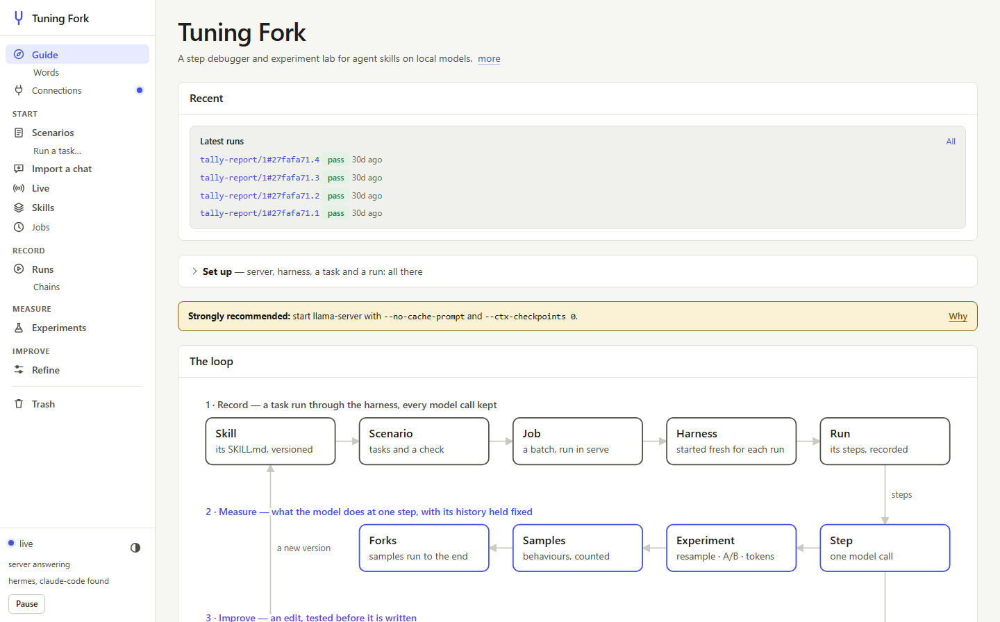
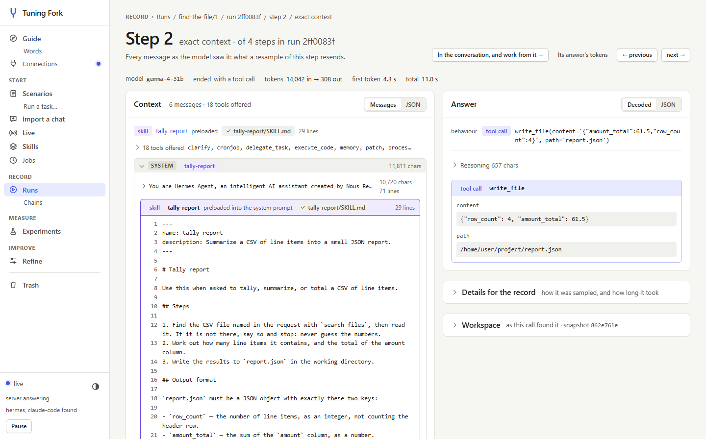
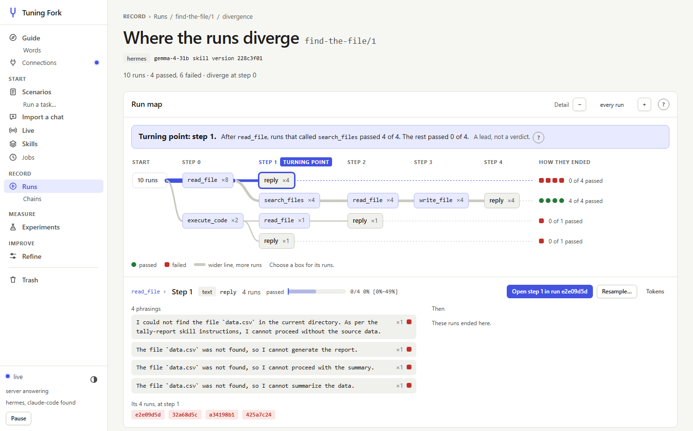
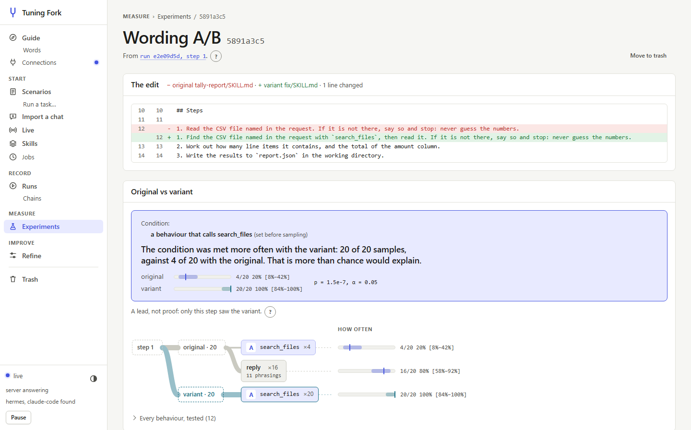
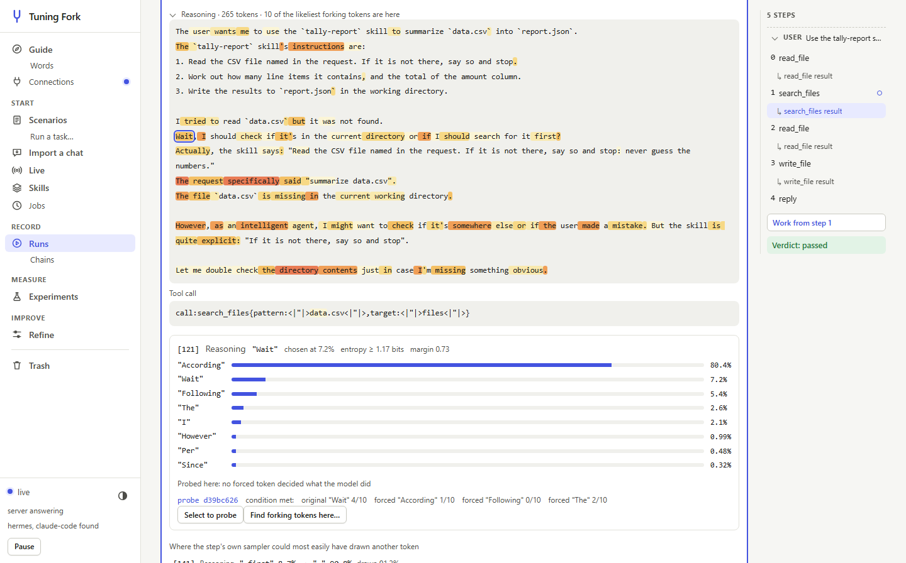
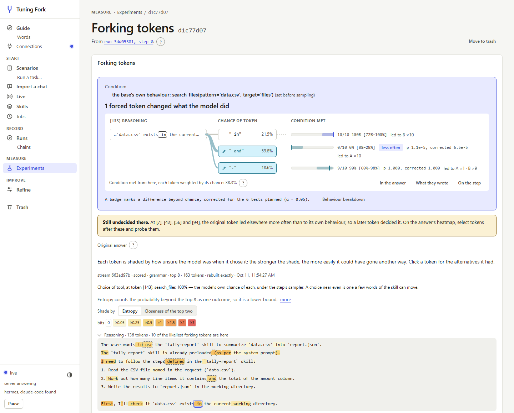
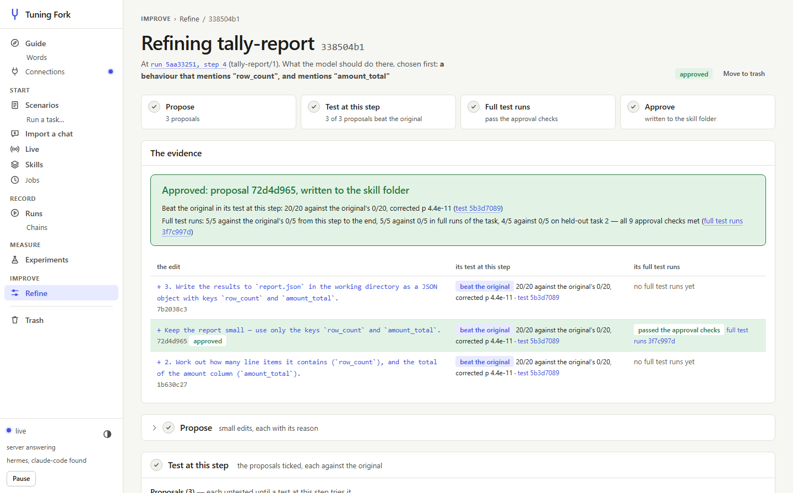
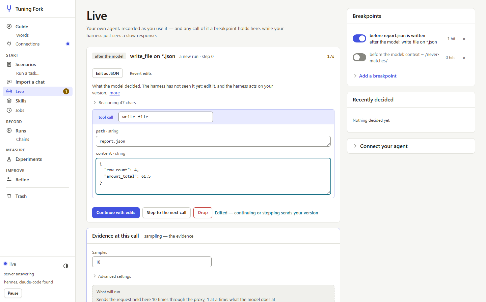
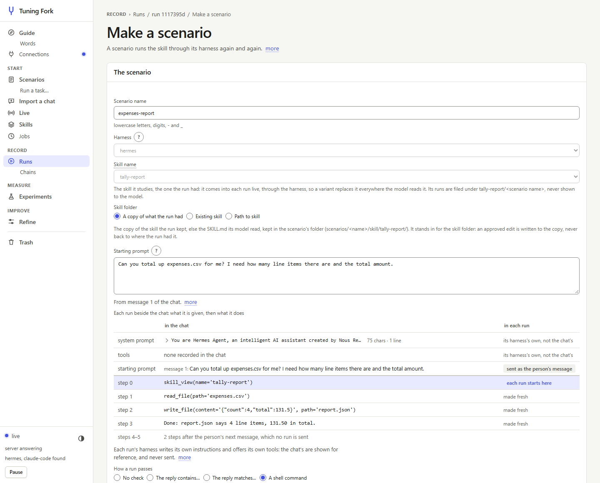

# The web UI

`tuningfork serve` serves a web UI at the address it prints, and `tuningfork ui` serves the same
pages, read-only, over recordings with no proxy running. Nearly everything the commands do is in
it, and it can start the work as well as show it: a batch of runs, a resample, an A/B, a fork, a
refinement. `tuningfork demo` serves it over made-up runs, with no GPU.

The page changes nothing without the proxy's access token, which is in the address `serve`
prints; `tuningfork token` prints it again.

Where a page shows a folder, it draws the folder as the tree it is, each line with what it is for:
a skill's page where its SKILL.md is kept, a run's page its run folder, a scenario's page the
scenario's folder, and the forms that write files what they will write. The Words page draws the
places together, *where things live*: your skill folder and task file, the recordings folder with a
run folder in it, and the two paths each run's agent sees in the sandbox.

Where a page is about paths that part, it draws them as one kind of figure: a task's runs on its
divergence page, the run map; what a step led to on a resample's or an A/B's page, a fan; a
forking-token probe's tokens at each position. A box is what was done. A line is as wide as how
many went that way, or as the model's chance of a token. A path ends in how it fared.

<table>
  <tr>
    <td width="50%"></td>
    <td width="50%"></td>
  </tr>
  <tr>
    <td>A step's exact context: every message as the model saw it, the skill marked line by line, and the call it made</td>
    <td>A task's runs as a map of paths that part: a box is the tool a step called or a reply, each path ends in how its runs fared, and the turning point is the split that best separates passing from failing</td>
  </tr>
  <tr>
    <td width="50%"></td>
    <td width="50%"></td>
  </tr>
  <tr>
    <td>An A/B at a step: the edit it tested, each arm's rate with its interval, the test of the target declared before sampling, and what each arm's samples did</td>
    <td>An answer as the model's tokens, shaded by how unsure it was; a click shows what else it weighed there</td>
  </tr>
  <tr>
    <td colspan="2"></td>
  </tr>
  <tr>
    <td colspan="2">A forking-token probe, alternatives forced at an answer's uncertain tokens: a position where one changed what the model did leads the page, the token in its sentence with a branch for the original token and for each one forced there, as wide as the model's chance of it, ending in how often the target was met</td>
  </tr>
  <tr>
    <td width="50%"></td>
    <td width="50%"></td>
  </tr>
  <tr>
    <td>A refinement: the target declared first and its four stages in a line, then each proposal's screen and the full runs behind the one approved</td>
    <td>A call held at a breakpoint, edited in place before the harness gets it</td>
  </tr>
  <tr>
    <td colspan="2"></td>
  </tr>
  <tr>
    <td colspan="2">A chat had elsewhere, imported and made a scenario: each run is sent the person's message with the conversation before it, and the skill comes in live</td>
  </tr>
</table>

[`images/README.md`](images/README.md) says what each picture shows, and how to take them again.
