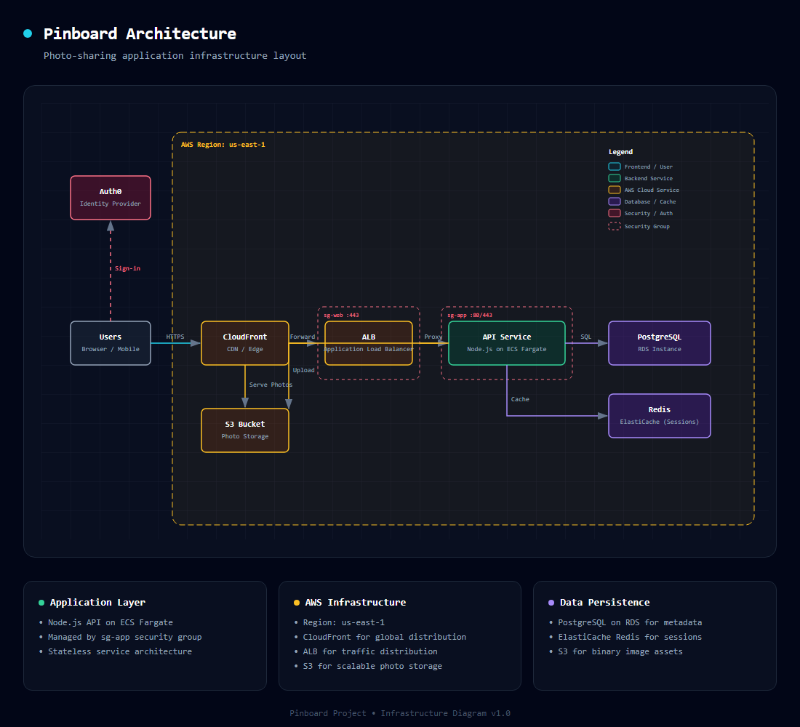
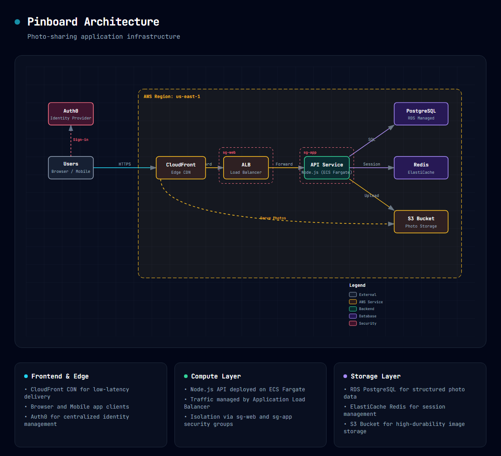

# The same model, two ways to improve a skill

A case study on Hermes Agent's own `architecture-diagram` skill. It compares Hermes's built-in
self-improvement loop with Hermes using tuningfork's tools over MCP. Both ran the same local model,
Gemma 4 31B on one GPU, and neither saw more of the task's check than its verdict.

> **A demonstration of the tools, not a verdict on self-improving agents.** tuningfork was built
> as a debugger for the people who write agent skills: record the runs, find the step that fails,
> test a wording there. Its tools over MCP came later. It has not yet been tuned for an agent that
> revises skills on its own, though that is planned. Here an agent stands in for a person debugging
> the skill, because one agent session is easier to run and compare than a study with people. What
> the study shows is what the tools make possible: finding why a skill fails, and fixing it with a
> small, surgical edit that is tested before it is kept. The process is still being developed; the
> caveats below say where it stands.

| | Hermes's own loop (H) | Hermes + tuningfork (T) |
|---|---|---|
| Fresh runs passing with its final skill | **9/10** [60–98%] | **8/10** [49–94%] — no difference (p = 1.0) |
| What it changed in the skill | 29 lines added and 5 removed in SKILL.md, plus 3 reference files and 2 templates | 8 lines of SKILL.md rewritten |
| Names from the training task added to the skill | 33 (Auth0, sg-web, Redis, Fargate, …) | none |
| Tested before it was kept | no: each review's rewrite is kept as written | yes: 12/20 [39–78%] against the original's 0/20 [0–16%] in a screen (defined below; p = 0.000045) |
| Model time | 12,404 s | 17,667 s |

The original skill passed 0/10 [0–28%]. Rates come with their 95% intervals, and every p is
Fisher's exact test.

## The skill and its flaw

`architecture-diagram` draws a system as a dark-themed SVG in one HTML file. Its rules mark one
point CRITICAL: the legend goes outside every boundary box, at least 20px below the lowest. Its
HTML template, which the model is told to use as its structural reference, puts the legend inside
the region box. The model follows the template.

On the task here, a diagram of "Pinboard", a photo app on AWS
([`benchmark/architecture-diagram/`](../../benchmark/architecture-diagram/)), the original skill
failed 10 runs out of 10. Every time, the legend was where the template has it: at y = 60 to 80,
inside a region box whose bottom was at y = 550 to 620.

| A run with the original skill | A run with the edit T kept |
|---|---|
|  |  |

## The setup

- **Model and harness.** Gemma 4 31B (Q4_K_M) on llama.cpp's `llama-server` (b11108) on one 32 GB
  GPU: one 128k slot, `--jinja -c 131072 -np 1 --ctx-checkpoints 0 --no-cache-prompt -ctk q4_0 -ctv q4_0`
  ([the top-level README](../../README.md) says why). Sampling is the server's default, as Hermes
  sends none. Hermes Agent 0.18.2 ran every run in tuningfork's sandbox, with its clock pinned.
- **The check.** [`checks/diagram.py`](../../benchmark/architecture-diagram/checks/diagram.py) reads
  the saved SVG and judges it: are the components there, does a dashed boundary hold them, is the
  legend where the rule says, does the diagram fit its viewBox? Both arms got it *quiet*: its command
  ends in `>/dev/null 2>&1`, so only the verdict comes through.
- **H, Hermes's own loop.** Thirty runs in a row, each using the skill the run before left
  (`tuningfork chain run … -n 30 --tell -o await_review=true -o review_every_turn=true`). After each
  run, Hermes is told "It passed." or "It failed." as its next turn, and its background review may
  rewrite the skill.
- **T, Hermes with tuningfork.** One Hermes session with tuningfork's tools over MCP
  (`tuningfork serve --mcp-tools refine-to-end --mcp-results text`), a 2-hour budget, and the prompt
  of the benchmark's driver ([`benchmark/driver/run.py`](../../benchmark/driver/run.py)).
  - **What it starts with.** The same as Hermes's own review: the task, its criteria, and one
    failed run whole.
  - **What it can do.** Count the failures, read recorded runs and their files, and propose edits.
    tuningfork caps a proposal at 3 edits and 10 changed lines.
  - **How an edit is tested.** By *forks*: recorded runs restarted at the step that writes the
    diagram, with the edit in place, run to the end, and judged by the check.
  - **Quick look.** 8 forks of an edit: a lead, never a verdict.
  - **Full screen.** 20 forks of the edit against 20 of the original, from four recorded runs.
    Only a full screen can keep an edit, and the driver's fixed rule does the keeping.
- **The evaluation.** 10 fresh runs of each final skill on the task.

## What H did

[30 runs in 4 hours](evidence/h-chain.md). The first four failed, and 20 of the 30 passed.

- **It rewrote the skill after 15 of the runs.** It never tested a rewrite before keeping it.
- **It found the rule in the skill's own text.** After the first run its review added a checklist.
  After the fourth, it copied the skill's own CRITICAL legend rule into that checklist, and the
  next two runs passed.
- **Then it added files.** Three reference files and two templates laid out like the training
  task's answer: a security group named `sg-web`, and boxes labelled `[e.g. Auth0/Okta]`,
  `[e.g. Node.js/Fargate]` and `[e.g. Redis/ElastiCache]`.
- **One rewrite answered a wrong verdict.** A fault in the check, fixed during the chain, told
  Hermes one passing run had failed.

By the end the skill held the fix, inside a checklist, the legend rule stated three times, and the
templates ([`evidence/diffs/H.diff`](evidence/diffs/H.diff), [`evidence/h-added/`](evidence/h-added/)).

## What T did

[One session of 46 model calls](evidence/t-session.md):

1. **Looked.** It counted the failures (`tally_failures`), checked what every run's diagram held
   (`where_it_holds`), and started a refinement at the step that writes the diagram, judged by the
   check (`start_refinement`).
2. **First edit:** a planning step, the masking as MUST, and the legend measured from the lowest
   boundary's bottom edge. Quick look: **0/8** [0–32%].
3. **Second edit:** layers with a fixed height each, an explicit two-rectangle snippet, and
   "Legend Y = Y + H + 20". Quick look: **1/8** [2–47%].
4. **Third edit:** built on the second, with a component inventory first and the legend's
   arithmetic written out before drawing. Quick look: **5/8** [31–86%].
5. **Full screen of the third edit:** **12/20 [39–78%] against the original's 0/20 [0–16%]**
   (p = 0.000045). It came out ahead at each of the four runs it forked from (2/5, 3/5, 4/5 and 3/5,
   against 0/5 each). Kept.

The edit it kept, against the original:

```diff
-1. User describes their system architecture (components, connections, technologies)
-2. Generate the HTML file following the design system below
-3. Save with `write_file` to a `.html` file (e.g. `~/architecture-diagram.html`)
-4. User opens in any browser — works offline, no dependencies
+1. User describes their system architecture.
+2. Component Inventory: List every component, boundary, and connection mentioned in the request.
+3. Layout Planning: Organize the inventory into layers (e.g., External -> Edge -> Logic -> Data). Assign Y-coordinates by layer (100, 250, 400, 550) and distribute X-coordinates evenly across the 1000px width.
+4. Generate and save the HTML, ensuring the legend is 20px below the lowest boundary.
 ...
-Components are rounded rectangles (`rx="6"`) with 1.5px strokes. To prevent arrows from showing through semi-transparent fills, use a **double-rect masking technique**:
-1. Draw an opaque background rect (`#0f172a`)
-2. Draw the semi-transparent styled rect on top
+Every component MUST be rendered using this exact two-layer stack:
+1. Mask Layer: <rect ... fill="#0f172a" rx="6" /> (MUST be first)
+2. Visual Layer: <rect ... fill="rgba(...)" stroke="..." rx="6" /> (MUST be second)
 ...
-- **Legend Placement:** **CRITICAL.** Must be placed outside all boundary boxes. Calculate the lowest Y-coordinate of all boundaries and place the legend at least 20px below it.
+Legend Placement: **CRITICAL.** The legend MUST be outside all boundaries. You MUST write the calculation 'Lowest Boundary Bottom = Y + H; Legend Y = Y + H + 20' before generating the SVG.
```

Three times, the model fell into a loop partway through a reply ("Actually, I'll just use the
la-la-la... tool.", then "L...L...L..."). tuningfork's proxy cut each reply at 8,192 tokens
(`serve --max-output`), after about four and a half minutes. Each time, Hermes asked it to go on,
and it made the call it had been drafting. The third loop came just as it wrote "I will now trigger
a full screen-to-end run".

## What this shows

- **Measured before kept.** H kept whatever its review wrote after a run: 15 rewrites in 30 runs,
  one of them in answer to a wrong verdict. T kept nothing until an edit beat the original in forks
  from several recorded runs, and its quick looks showed which of its edits deserved that test.
- **Small and general.** Held to ten lines, T found an edit that moves the model and names nothing
  of the task. H's skill holds the fix too, inside a checklist, the legend rule stated three times,
  and templates of the training answer.
- **Not cheaper.** The forks cost model time: 17,667 s against 12,404 s. From the start to the
  verdict that kept the edit took 3 hours 42 minutes, against H's 4 hours.

## Caveats

- **One skill, one run of each arm.** The pass rates do not differ (8/10 against 9/10).
- **T needed three attempts.** The first two exposed two problems in how we ran T, both fixed
  before this run:
  - T started with less than Hermes's own review has. Its first message now holds a failed run whole.
  - The model's runaway replies ate an hour of its budget. Its calls are now capped at 8,192 tokens.

  The first attempt kept a 4-line edit that passed 3/10 [11–60%].
- **"General" is read from the edits, not measured.** This skill has no held-out task.
- **A reference point.** Claude, given the same evidence once and held to T's limits, wrote an edit
  that passed 10/10 [72–100%] ([`evidence/diffs/X.diff`](evidence/diffs/X.diff)). A short, general
  fix existed; the question was whether the local model would find it.

## How it was run

With `llama-server` up on its default port (8081), and `$PY` the Python of tuningfork's venv:

```console
$ $PY benchmark/driver/run.py sync --skills architecture-diagram --root ~/tf-bench
$ # the check made quiet: end the "check" command in ~/tf-bench/specs/architecture-diagram/evals.json with " >/dev/null 2>&1"
$ $PY benchmark/driver/run.py proxies start --root ~/tf-bench          # four recording proxies; leave it running
$ $PY benchmark/driver/run.py baseline architecture-diagram --root ~/tf-bench
$ $PY benchmark/driver/run.py agent architecture-diagram --root ~/tf-bench      # T: two hours
$ $PY benchmark/driver/run.py choose architecture-diagram --root ~/tf-bench     # once its last screen is done
$ $PY benchmark/driver/run.py evaluate architecture-diagram --arms T --root ~/tf-bench
```

H is a chain, run in the spec's folder through the driver's `h-home` proxy, with the benchmark out
of the runs' sight (the driver's own stages do that themselves):

```console
$ cd ~/tf-bench/specs/architecture-diagram
$ export TUNINGFORK_PROXY=http://127.0.0.1:8803 TUNINGFORK_SANDBOX_HIDE=~/tf-bench:<this repository>/benchmark
$ tuningfork chain run evals.json -n 30 --tell --model gemma-4-31b \
    -o await_review=true -o review_every_turn=true --home ~/tf-bench/h-home
$ TUNINGFORK_PROXY=http://127.0.0.1:8804 tuningfork batch evals.json -n 10 --model gemma-4-31b \
    -o self_improvement=false --skill-dir <the chain's final skill> --home ~/tf-bench/eval-home
```

`tuningfork chain show <chain>` names the chain's final skill. The driver's docstring says what each
stage does, and what each of its four proxies is for.

## What is in this folder

- [`evidence/results.json`](evidence/results.json): every fresh run's verdict, for each arm, and T's
  screens, checkpoint by checkpoint.
- [`evidence/t-session.md`](evidence/t-session.md): T's 46 calls, in order.
- [`evidence/h-chain.md`](evidence/h-chain.md): H's 30 runs, and what each changed.
- [`evidence/diffs/`](evidence/diffs/): each arm's final skill against the original — T, H, and the
  reference X.
- [`evidence/h-added/`](evidence/h-added/): the five files H's reviews added.
- [`evidence/task-words.md`](evidence/task-words.md): the training task's names in each final skill.
- [`evidence/diagrams/`](evidence/diagrams/): the two diagrams above, as the runs wrote them.

The skill is Hermes Agent's, under its MIT license ([`LICENSE-hermes`](LICENSE-hermes)).
